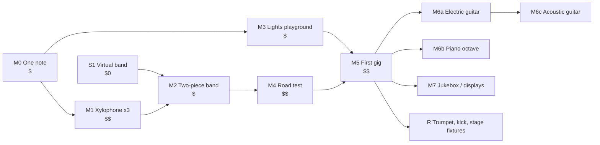

# Roadmap

Last updated: 2026-11-10

The order MetroDom gets built in. Each milestone is a **small, cheap build that plays real
music and tests one or two architecture bets**. A milestone ends with a retro: each bet it
tested moves its ADR to **Accepted**, or the ADR is revised before anything bigger is built
on it. Details and checklists live in the exec plans ([PLANS.md](PLANS.md)). This file only
sets the order and the exit criteria.

Rules:
1. **Cheapest test of the riskiest bet first.** Don't buy for milestone N+2 to save shipping.
2. **Every milestone makes a sound.** No hardware milestone that only produces a PCB or a box.
3. **Software runs ahead.** The Conductor is the owner's strength. Rehearse it against
   virtual instruments so hardware milestones never wait on code.
4. **One new hard thing per milestone.** New mechanics *or* new electronics *or* new venue, never all three.

Costs are rough part costs, excluding the starter tool kit
([hardware/README.md](../hardware/README.md#starter-tool-kit)). $ < 50 · $$ < 200 · $$$ > 200.

## Architecture bets under test

| Bet | ADR | Tested in |
| --- | --- | --- |
| B1: Instruments as plain USB-MIDI devices work with stock tools | [0001](design-docs/0001-midi-is-the-contract.md) | M0 |
| B2: One generic firmware + swappable brain + self-describing body | [0006](design-docs/0006-swappable-instrument-brains.md), [0007](design-docs/0007-instrument-discovery.md) | M1 |
| B3: Lookahead from measured latency aligns instruments | [0004](design-docs/0004-latency-compensation.md) | S1, M2 |
| B4: Shared modules carry over to a different instrument | [0009](design-docs/0009-shared-hardware-modules.md) | M2 |
| B5: Hardware records in the repo stay useful | [0008](design-docs/0008-hardware-as-code.md) | M1 onwards |
| B6: Lights on the MIDI timeline | [0011](design-docs/0011-visuals-are-part-of-the-band.md) | M3 |
| B7: Road-ready cases and a fast setup | [0010](design-docs/0010-road-ready-instruments.md) | M4 |
| B8: One Control API, modes are policy | [0003](design-docs/0003-control-api.md), [0005](design-docs/0005-deployment-modes-are-policy.md) | M5, M7 |

## Milestones

### S1: Virtual band (software track, $0, start now)
Conductor plays a song to two virtual MIDI instruments with **simulated** latency (e.g. 10 ms
and 35 ms) and proves the scheduler aligns them.
- Exit: scheduler with fake-clock tests, tap tempo, panic, all against virtual ports. Arranger maps tracks to profiles.
- Plan: [0001](exec-plans/active/0001-foundation-reboot.md) Phase 2.

### M0: One note ($)
Pico + one MOSFET + flyback diode + one solenoid on the bench supply, running the first cut of
the generic firmware.
- Bets: B1.
- Exit: a stock DAW or keyboard plays the solenoid over USB-MIDI with no MetroDom software.
  `metrodom play` plays it too. Fixed strike pulse. Unplugging USB = off. Coil temperature after
  1 minute at max rate written down.
- Plans: [0002](exec-plans/active/0002-hardware-bootstrap.md) H1, [0001](exec-plans/active/0001-foundation-reboot.md) Phase 1.

### M1: Three-note xylophone on the brain/body split ($$)
Three `striker-solenoid` rev A (one test print, then a batch), PCA9685 + ID EEPROM on
perfboard, on the owner's xylophone.
- Bets: B2, B5.
- Exit: Conductor discovers it via SysEx Identity, reads its profile from the body EEPROM.
  A spare Pico swapped in under a minute plays without a laptop. Latency measured per note
  (a phone recording is fine before the jig exists). First build records and stock updates committed.
- Pivot signals: I²C latency or reliability bad → direct GPIO pin map. EEPROM profile too
  fiddly → profile file on the Conductor keyed by USB serial.

### M2: Two-piece band ($)
Add a **snare (from the owner's drum set) plus a cowbell or woodblock**, using the same striker,
driver and backplane. Only the frame, tips and profile are new.
- Bets: B3 (for real), B4.
- Exit: plays a song across xylophone + drums, following tap tempo, with measured alignment
  ≤ 5 ms. Retro lists every part that *wasn't* reused and why.

### M3: Lights playground ($, can run alongside M1–M2)
WLED strip + QLC+ driven by pads, then accent LEDs on the xylophone body.
- Bets: B6 (tier 1 accent, and MIDI → light scenes).
- Exit: pads change scenes through sACN; xylophone LEDs flash with its notes from the same Note On.
- Plan: [0003](exec-plans/active/0003-visuals.md) V0–V1.

### M4: Road test ($$)
Full-octave xylophone and the drum pieces, each in a crate (`case-road`), `power-entry` with a
kill switch, a minimal head case.
- Bets: B7.
- Exit: load, drive 30+ minutes, set up alone, timed. Everything that came loose is fixed in a
  module revision. Decide 12 V vs 24 V and buy-vs-build cases with real data.

### M5: First gig ($$)
A short set for friends or an open mic: setlist, live pads, tap tempo, phone panic, reactive lights.
- Bets: B8 (live-band policy), B3 under stage conditions, B6 tier 2 (Conductor → sACN).
- Exit: a 20–30 minute set with no unsafe events. Retro feeds every ADR still Proposed.
- Spec: [live band](product-specs/live-band.md).

### M6: New mechanics, one at a time ($$–$$$ each)
Each one adds one new job to the module library ([ADR 0009](design-docs/0009-shared-hardware-modules.md)).
Order follows [musical-instruments.csv](../hardware/inventory/musical-instruments.csv) `metrodom_fit`:
- **M6a Electric guitar:** open tuning, 6 pickers (new `picker-*` module), then a slide. The amp
  hides actuator noise, so it's the easier guitar.
- **M6b Piano, one octave:** 12 `presser-solenoid` and velocity. The piano doesn't travel, so it
  also tests an installed, non-road rig.
- **M6c Acoustic guitar:** reuses M6a's modules. The new problem is actuator noise.

### M7: Jukebox and displays ($$)
Matrix display with join QR, crowd queue, venue policy profile.
- Bets: B8 (jukebox policy, untrusted input).
- Spec: [crowd jukebox](product-specs/crowd-jukebox.md). Plan: [0003](exec-plans/active/0003-visuals.md) V4.

### R: Research spikes (time-boxed, no commitment)
- **Trumpet:** valves are easy. Air supply and artificial lips are research. Uses the compressor.
- **Kick drum and hi-hat:** need stronger actuators, likely the 24 V decision.
- **Stage fixtures:** DMX pars and the DMX node ([0003](exec-plans/active/0003-visuals.md) V3).

## Changing this roadmap
Reorder freely when a retro says so. Record why in the decisions log of the affected exec plan,
and update `Last updated`.
