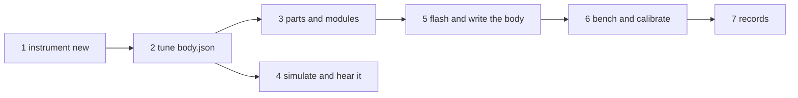

# Building a new instrument

Status: **Partly built** ([plan 0006](../exec-plans/active/0006-new-instrument-dev-loop.md)).
Steps 1–4 work today. Step 5's one-command flash and step 6's `metrodom bench` are still
planned; until they're built, those steps say what to do instead.

A MetroDom instrument is a **body**: actuators on a real instrument, a driver board, and an ID
EEPROM that says what it is. Every instrument runs the same **brain** firmware, and the brain
becomes whatever the body says it is ([ADR 0006](../design-docs/0006-swappable-instrument-brains.md)).
So a new instrument needs no firmware change, just two files and the hardware.



## 1. Start it

```bash
metrodom instrument new snare --notes 38 --plays drum-kit
```

This creates `Instruments/snare/` with three files:

| File | What | Checked by |
| --- | --- | --- |
| `instrument.toml` | Which shared modules it's built from, and how many | `python3 scripts/check_hardware.py` |
| `body.json` | Notes → outputs, pulse lengths, limits: what the brain enforces | `metrodom body check` |
| `README.md` | Wiring, power, bench results: fill it in as you build | `python3 scripts/check_docs.py` |

| Option | Default | |
| --- | --- | --- |
| `--notes` | `60` | One actuator per note: `C5-E5`, `72,74,76`, `38`. At most 16 |
| `--driver` | `pca9685` | The [body-backplane](../../hardware/modules/body-backplane/README.md). `gpio` drives brain pins directly (a bench rig) |
| `--actuator` | `striker-solenoid` | Any strike, press, pluck or damp module in [hardware/modules](../../hardware/README.md) |
| `--plays` | none | The real instrument, from `hardware/inventory/musical-instruments.csv` |
| `--name` | `MetroDom <id>` | The USB name a DAW and `metrodom devices` show |

You can also copy [Instruments/_template/](../../Instruments/_template/README.md) by hand.

## 2. Tune the body

The new body starts with safe values for a small solenoid: a 30 ms strike at full velocity,
12 ms at the softest, 60 ms between repeats, 30% duty, and polyphony 2. Edit `body.json` for
your actuators. The [body record](body-record.md) lists every field and its limits. Then check it:

```bash
metrodom body check Instruments/snare/body.json   # one body, with its table
metrodom body check                               # every Instruments/*/body.json
```

`body check` uses the firmware's own rules, so a body that passes will be accepted by a brain.
No body can ask for a pulse over 250 ms or a duty over 50%. Raising those limits takes a firmware change.

## 3. Parts and modules

```bash
python3 scripts/check_hardware.py              # the modules exist, and the body fits them
python3 scripts/check_hardware.py --buildable  # what you can build from stock, what's short
```

`check_hardware.py` checks `body.json` against `instrument.toml`, so the two can't drift apart
as you edit them:

| Check | Fix |
| --- | --- |
| The body's `id` is the instrument's `id` | Make them match (`instrument new` does) |
| A `body-backplane` holds the body | Add it to `instrument.toml` |
| A driver channel per note (`driver-mosfet-8ch` switches 8), and PCA9685 outputs within them | Add a driver, or renumber outputs from 0 |
| An actuator module (strike, press, pluck or damp) per note | Raise the actuator's `qty` |
| `led-accent` when the body has `accent` LEDs | Add the module |
| An instrument with `brain-pico` has a `body.json` | `instrument new` writes one |

Each module's README has its wiring, assembly and bench test. A module that doesn't exist yet
starts from `hardware/modules/_template/` ([hardware/README.md](../../hardware/README.md#everyday-workflows)).

## 4. Hear it before soldering

Run the song through a software brain running your body. It decides exactly as the firmware
will, because both run the same [parity vectors](../../Instruments/metrodom_brain/test/vectors/README.md):

```bash
metrodom simulate song.mid --body Instruments/snare/body.json
```

The last section, **Played straight to each brain**, counts what the brain would refuse from a
DAW, by reason: still striking, under `minIntervalMs`, over duty, over polyphony. Lots of
interval refusals on a fast part? Lower `minIntervalMs` if the actuator can take it, or accept
that it thins the part. `play` never sends those notes in the first place: its governor holds
them back (the band table's **Held** column).

To hear it in real time, or play it from a keyboard or DAW:

```bash
metrodom virtual --body Instruments/snare/body.json   # terminal 1: a "MetroDom snare" port
metrodom play song.mid --arrange                      # terminal 2: the band, snare included
```

Each strike prints its pulse length and LED color, and each refusal prints why
([virtual band](virtual-band.md#a-bodys-brain-in-software---body)).

## 5. Flash the brain and write the body

Flash the one brain firmware ([build and flash](../../Instruments/metrodom_brain/README.md#build-and-flash),
Arduino IDE for now; plan 0006 N5 makes it one command). Wire the brain to the body, then:

```bash
metrodom devices --identify                    # a "MetroDom brain" (no body yet)
metrodom body write "MetroDom brain" Instruments/snare/body.json
```

Hold the body's write button when asked. The brain checks the record, stores it, reads it back
and restarts as "MetroDom snare". From then on, any brain plugged into this body becomes the snare.

## 6. Bench and calibrate

Until `metrodom bench` exists (plan 0006 N6), do it by hand:

1. Play each note slowly from a DAW or `metrodom route`, soft and then hard. Every note sounds,
   and nothing stays on.
2. Unplug USB mid-note. Everything goes off.
3. Play one note at its fastest repeat for a minute, then feel the coil. Write down how warm it is.
4. Measure latency with an onset input (a [trigger-piezo](../../hardware/modules/trigger-piezo/module.toml)
   or a mic-to-MIDI box), then store it in the body so every Conductor schedules it right:

```bash
metrodom calibrate -o "MetroDom snare" --onsets "trigger" --onset-latency 2
metrodom body write "MetroDom snare" --calibrated
```

No onset input yet? Skip step 4. The latency stays "not measured", and a phone recording of
the strikes is enough for a first number ([calibration](calibration.md)).

## 7. Records

In the same commit:
- Fill in the instrument's README: wiring, power, the bench table.
- Write a build record `hardware/builds/MD-SNARE-001.md` ([template](../../hardware/builds/README.md)),
  and take the parts you used off `hardware/inventory/stock.csv`.
- Change `status` in `instrument.toml` from `planned` to `prototype`.
- Run `python3 scripts/check_docs.py`, `python3 scripts/check_hardware.py` and `metrodom body check`.
