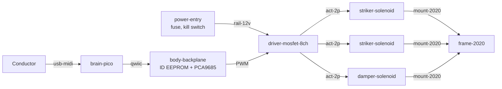

# MetroDom hardware

Everything physical: parts, what's in stock, reusable modules, and the units actually built.
Format and rules: [ADR 0008](../docs/design-docs/0008-hardware-as-code.md). Which modules exist
and why: [ADR 0009](../docs/design-docs/0009-shared-hardware-modules.md). Roadmap:
[exec plan 0002](../docs/exec-plans/active/0002-hardware-bootstrap.md).

```
hardware/
  interfaces.md          connector / voltage / mounting standards (the "API" between modules)
  parts/catalog.csv      every part we use: what it is, where to buy, datasheet
  inventory/stock.csv    what's physically on the shelf, how many, which bin
  modules/<id>/          reusable assemblies: module.toml, bom.csv, README.md, cad/
  builds/<serial>.md     one record per physical unit built (labelled MD-…-NNN)
Instruments/<name>/instrument.toml   which modules an instrument is made of
```

## If you know software, read this table

| Software | Hardware here |
| --- | --- |
| Package registry | `parts/catalog.csv` |
| Local cache / `node_modules` | `inventory/stock.csv` |
| Library with a public API | Module (`modules/<id>/`) |
| Interface / type signature | Connector standard in [interfaces.md](interfaces.md) |
| `package.json` dependencies | `bom.csv` |
| Semver major bump | Module revision bump (`A` → `B`) when interfaces or BOM change |
| App composed of libraries | Instrument (`instrument.toml`) |
| Deployment / lockfile | Build record with a serial number on a physical label |
| Unit test | Bench test in the module README, with pass/fail numbers |
| Linter in CI | `scripts/check_hardware.py` |
| Architecture diagram | Mermaid block diagram in the README. A photo for wiring |

## How an instrument is composed



Only `frame-2020` tips, layout and the profile change between percussion instruments.

## Everyday workflows

- **Bought parts:** add any new part to `catalog.csv`, then add/increase its row in `stock.csv`.
- **Built something:** write `builds/MD-<MODULE>-NNN.md` from the
  [template](builds/README.md), decrement the parts you used in `stock.csv`, same commit.
- **New module:** copy `modules/_template/`, give it an id, list interfaces from
  [interfaces.md](interfaces.md), fill the BOM with catalog ids.
- **Can I build it?** `python3 scripts/check_hardware.py --buildable` joins every BOM with stock.

Always run `python3 scripts/check_hardware.py` before committing hardware changes.

## Starter tool kit

What a beginner needs before Phase H1. Buy decent versions of the first four. They keep you safe.

| Tool | Why |
| --- | --- |
| Bench power supply with **current limit** (0–30 V, 0–5 A) | A shorted circuit just stops instead of smoking. The most important beginner tool |
| Multimeter | Check voltage, continuity, and current through a solenoid |
| Temperature-controlled soldering iron, solder, flux, brass tip cleaner | Perfboard and connectors |
| Safety glasses | Solder spits, springs fly, solenoids slam |
| Wire strippers, flush cutters, JST crimp tool + kits (XH, SH) | Making the standard connectors in [interfaces.md](interfaces.md) |
| Breadboard + jumper wires | Phase H1 experiments |
| Assorted flyback diodes, logic-level MOSFETs, resistors, fuses | They are cheap and you will burn some |
| 3D printer access | Brackets, mallet tips, adapter plates |
| Optional: cheap USB logic analyzer | See I²C and pulse timing when something is "almost working" |

## Beginner safety rules
1. Bring up every new circuit on the bench supply with a **low current limit**, then raise it.
2. Every coil (solenoid, relay, motor) gets a **flyback diode**. No exceptions.
3. Actuators get a **fixed pulse**, never "on until told off" ([RELIABILITY.md](../docs/RELIABILITY.md)).
4. Logic ground and actuator ground meet at **one point**. Actuator current never flows through
   the Pico.
5. Every rail is **fused** at `power-entry`, and the kill switch cuts the actuator rail.
