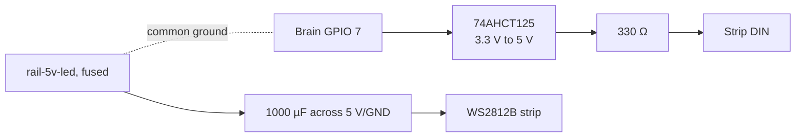

# led-accent (rev A)

A short WS2812B strip on an instrument body that flashes with each strike: the audience sees which
robot played which note ([ADR 0011](../../../docs/design-docs/0011-visuals-are-part-of-the-band.md)
tier 1). The body's own brain drives it from the same Note On, so there's no extra protocol. Its
size and colors are in the [body record](../../../docs/references/body-record.md#accent-leds).
First user: the M1 xylophone (`bodies/m1-xylophone-accent.json`, three LEDs under each bar).

## Interfaces
| Interface | Role | Notes |
| --- | --- | --- |
| `led-3p` | input | Data from brain GPIO 7 through the level shifter |
| `rail-5v-led` | power | Its own fused 5 V supply, never the actuator rail |

## Block / wiring diagram

## What the firmware expects
| Part | Pin / value | Why |
| --- | --- | --- |
| Strip data | Brain GPIO 7, via a 74AHCT125 powered from the LED 5 V | WS2812B wants 0.7 × 5 V for a high; the Pico gives 3.3 V |
| Strip length | At most 64 LEDs, the body record's `accent.leds` | The firmware clears exactly that many at boot and on panic |
| Brightness | At most 25%, the body's `accent.maxBrightnessPercent` | The firmware ceiling: 64 LEDs × 60 mA × 25% ≈ 1 A worst case |
| Ground | LED supply ground joined to the brain's | Data needs a common reference |

## Parts
See `bom.csv`. A printed diffuser over the strip (PLA is fine at home) is still to be drawn.

## Assembly
1. Fuse the LED 5 V supply (1.5 A for up to 64 LEDs at the 25% ceiling).
2. 1000 µF across 5 V and GND at the strip's input.
3. 74AHCT125: VCC to LED 5 V, one buffer from GPIO 7 to the strip's DIN through 330 Ω.
4. Join the grounds. Write the body with its `accent` and per-note `led` entries
   (`metrodom body write`).

## Bench test
| Test | Pass when |
| --- | --- |
| Boot | Every LED off |
| Play each note from a keyboard | Only that note's LEDs flash, in its color, for `flashMs` |
| Soft vs hard Note On | The soft one is dimmer, never dark |
| Note repeated faster than `minIntervalMs` | The refused repeat doesn't flash |
| Panic (CC 120) or unplug USB mid-flash | Every LED off at once |
| Full strip at the ceiling, white | Current under the fuse; strip end isn't visibly dimmer |

## Known limits & safety
- Not built (status `planned`); the firmware side is host-tested only (TD-29).
- Sending the strip takes about 30 µs per LED (2 ms for 64), during which the brain's loop waits.
  Pulse ends can come up to that late; strikes are 12 ms and up, and the watchdog is 500 ms.
- Brightness is capped in firmware, but a stuck-high data line can still light a strip at full
  white on power-up glitches. Size the fuse for the strip, not the cap.

## Revision history
- A: first version.
