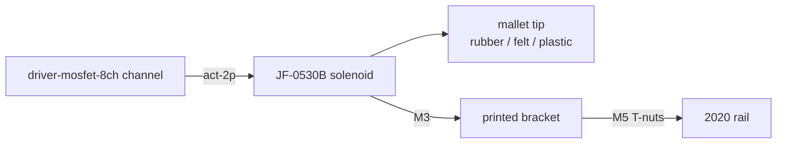

# striker-solenoid (rev A)

A push solenoid that flicks a mallet into a bar, key or drum head and springs back. The
workhorse of every percussion instrument in [ADR 0009](../../../docs/design-docs/0009-shared-hardware-modules.md).
The presser and damper modules reuse the same solenoid, bracket and connector with a different tip.

Status: **planned**. Nothing below is built or measured yet.

## Interfaces
| Interface | Role | Notes |
| --- | --- | --- |
| `act-2p` | input | Driven by one channel of `driver-mosfet-8ch`. Flyback diode is on the driver |
| `mount-2020` | mechanical | Printed bracket bolts to any 2020 rail, height adjustable |

## Block diagram

## Parts
See [bom.csv](bom.csv). Planned printed parts (`cad/`, OpenSCAD): bracket with slotted height
adjust, and swappable mallet tips that press onto the plunger.

## Bench test (draft, numbers to be confirmed in Phase H3)
| Test | Pass when |
| --- | --- |
| Single strike, 30 ms pulse at 12 V | Clean single note, no double bounce |
| Endurance: 8 strikes/s for 60 s | Coil < 60 °C, timing still consistent |
| Stuck-on protection | Firmware never holds it on longer than the profile's `maxOnMs` |
| Latency (via `latency-jig`) | Recorded per note in the instrument profile |

## Known limits & safety
- Continuous duty will overheat the coil. Always pulse.
- ~1 A at 12 V per strike: size the rail for the instrument's polyphony.

## Revision history
- A: planned.
